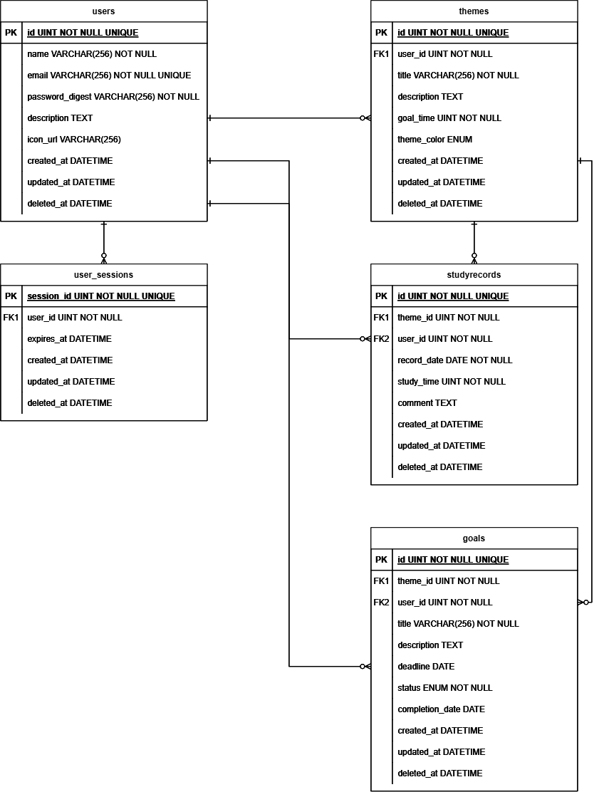

# サンプルアプリ仕様案
## 概要
勉強の記録や目標を管理できるアプリケーション
- サインアップ、サインイン、サインアウトができる。
- 学習記録の管理ができる。
- 学習テーマの設定ができる。学習テーマは、タイトル、説明、1日当たりの目標学習時間を設定できる。
- 各テーマごとに学習記録の設定ができる。
- 学習記録は、日付、テーマ、学習時間、メモ（学習内容）を記録できる。
- 目標を設定できる。目標は、紐づく学習テーマ、期限を設定できる。
- ダッシュボードで、学習時間の予実の推移を確認できる。
## 設計
### フロントエンド：ページ一覧
| 画面名 | URL | 概要 |
| ---- | ---- | ---- |
| サインイン、サインアップ画面 | / | タブでサインイン、サインアップフォームを表示する。ログイン済みの場合は/dashboardにリダイレクトする。 |
| ダッシュボード | /dashboard | 今日、今週の学習時間、目標学習時間を表示する。直近の学習時間をグラフ表示する。テーマ一覧、目標一覧を表示する。学習記録を設定できる。テーマ画面、目標画面へ遷移できる |
| 学習テーマ一覧画面 | /themes | 学習テーマ一覧が表示される。モーダルで学習テーマを追加、編集できる。 |
| 目標一覧画面 | /goals | 目標一覧が表示される。モーダルで目標を追加、編集できる。 |
### バックエンド：API一覧
| URL | METHOD | 認可 | 説明 |
| ---- | ---- | ---- | ---- |
| /users | GET | する | ログイン中のユーザーの情報を返す。 |
| /users | POST | しない | ユーザー情報を新規登録する。 |
| /users | PUT | する | ログイン中のユーザーの情報を更新する。 |
| /signin | POST | しない | リクエストボディのemailとpasswordを検証する。問題なければ、session_idとしてランダムなuuidを生成し、user_sessionsテーブルに登録する。クライアントのCookieにsession_idを登録する |
| /signout | DELETE | する | user_sessionsの該当のレコードを削除する。クライアントのcookieを削除する。 |
| /dashboard | GET | する | ダッシュボード画面に表示する情報を返す。 |
| /themes | GET | する | ユーザーの学習テーマ一覧を返す。 |
| /themes | POST | する| 学習テーマを新規登録する |
| /themes/:theme_id | PUT | する | theme_idで指定した学習テーマの情報を更新する。 |
| /themes/:theme_id | DELETE | する | theme_idで指定した学習テーマの情報を削除する。 |
| /themes/:theme_id/studyrecords?from=:from&to=:to | GET | する | theme_idに紐づく学習記録を取得する。from,toで取得する期間を指定できる。指定がない場合は全件取得 |
| /themes/:theme_id/studyrecords | POST | する | theme_idで指定したテーマの学習記録を登録する |
| /studyrecords/:id | PUT | する | idで指定したテーマの学習記録を更新する |
| /studyrecords/:id | DELETE | する | idで指定したテーマの学習記録を削除する |
| /goals | GET | する | ユーザーの目標の情報を取得する。 |
| /goals | POST | する | ユーザーの目標の情報を投稿する |
| /goals/:id | PUT | する | idで指定した目標の情報を更新する。 |
| /goals/:id | DELETE | する | idで指定した目標の情報を削除する。 |
### 認証認可方法
- サーバーサイドセッションによる認証認可方式を採用する。セッション情報はuser_sessionsテーブルに保存する。（余力があればredisなどでの管理への変更を検討する）
#### 認証(サインイン)
バックエンド側の処理  
1. リクエストに含まれるemail, passwordを検証する。usersテーブルからemailでレコードを検索し、該当レコードのpassword_digestカラムとリクエストのpasswordのハッシュを比較する。問題ない場合のみ以下の処理を行う
2. ランダムなuuidを生成しuser_sessionsのsession_idとしてレコードを追加する。expires_atには1日後を設定する。
3. session_idをクライアントのCookieに登録する。（`HttpOnly`（JSからの参照不可＝XSS対策）、`Secure`（HTTPS通信限定）、`SameSite=Lax`）
#### 認可
1. クライアントは、リクエスト時にCookieヘッダーにsession_idを自動付与して送信する。
2. バックエンドは、リクエストヘッダのsession_idをキーにして、user_sessionsを検索する。ただし、expires_atが現在時刻以前であるものは除外する。
    - 検索した結果が1件以上ある場合、最初に取得したレコードのuser_idからログインユーザーを特定してリクエストを処理する。
    - ヘッダにsession_idがない、または検索した結果が0件である場合、リクエストを拒否する。

### テーブル設計
#### users
| PK | FK | カラム名 | データ型 | NOT NULL | UNIQUE | 説明 |
| ---- | ---- | ---- | ---- | ---- | ---- | ---- |
| 〇 | - | id | uint | 〇 | 〇 ||
| - | - | name | varchar(256) | 〇 | - | ユーザーのハンドルネーム |
| - | - | email | varchar(256) | 〇 | 〇 | ユーザーのメールアドレス（サインインに使用) |
| - | - | password_digest | varchar(256) | 〇 | - | パスワードのハッシュ値 |
| - | - | description | text | - | - | ユーザーの自己紹介文 |
| - | - | icon_url | varchar(256) | - | - | ユーザーのアイコン画像のURL(画像そのものはamazon s3に保存) |
| - | - | created_at | datetime | - | - | レコード作成日 |
| - | - | updated_at | datetime | - | - | レコード更新日 |
| - | - | deleted_at | datetime | - | - | レコード削除日 |
#### user_sessions
| PK | FK | カラム名 | データ型 | NOT NULL | UNIQUE | 説明 |
| ---- | ---- | ---- | ---- | ---- | ---- | ---- |
| - | - | id | uint | 〇 | 〇 | 自動生成されるが使用しない |
| 〇 | - | session_id | varchar(256) | 〇 | 〇 | ログイン毎にランダムに生成するuuid |
| - | 〇 | user_id | uint | 〇 | - | ログインユーザーのid |
| - | - | expires_at | datetime | - | - | 有効期限 |
| - | - | created_at | datetime | - | - | レコード作成日 |
| - | - | updated_at | datetime | - | - | レコード更新日 |
| - | - | deleted_at | datetime | - | - | レコード削除日(このテーブルに限りレコードを物理削除するので使用しない) |

#### themes
| PK | FK | カラム名 | データ型 | NOT NULL | UNIQUE | 説明 |
| ---- | ---- | ---- | ---- | ---- | ---- | ---- |
| 〇 | - | id | uint | 〇 | 〇 ||
| - | 〇 | user_id | uint | 〇 | - | 紐づくusersレコードのid |
| - | - | title | varchar(256) | 〇 | - | 学習テーマ名 |
| - | - | description | text | - | - | テーマの説明 |
| - | - | goal_time | uint | 〇 | - | 目標学習時間（分単位） |
| - | - | theme_color | enum | - | - | テーマカラー（グラフ表示などに使用） |
| - | - | created_at | datetime | - | - | カラム作成日 |
| - | - | updated_at | datetime | - | - | カラム更新日 |
| - | - | deleted_at | datetime | - | - | カラム削除日 |
#### studyrecords
| PK | FK | カラム名 | データ型 | NOT NULL | UNIQUE | 説明 |
| ---- | ---- | ---- | ---- | ---- | ---- | ---- |
| 〇 | - | id | uint | 〇 | 〇 ||
| - | 〇 | theme_id | uint | 〇 | - | 紐づくthemesレコードのid |
| - | 〇 | user_id | uint | 〇 | - | 紐づくusersレコードのid |
| - | - | record_date | date | 〇 | - | 対象日付 |
| - | - | study_time | uint | 〇 | - | 学習時間（分単位） |
| - | - | comment | text | - | - | コメント |
| - | - | created_at | datetime | - | - | カラム作成日 |
| - | - | updated_at | datetime | - | - | カラム更新日 |
| - | - | deleted_at | datetime | - | - | カラム削除日 |
#### goals
| PK | FK | カラム名 | データ型 | NOT NULL | UNIQUE | 説明 |
| ---- | ---- | ---- | ---- | ---- | ---- | ---- |
| 〇 | - | id | uint | 〇 | 〇 ||
| - | 〇 | theme_id | uint | 〇 | - | 紐づくthemesレコードのid |
| - | 〇 | user_id | uint | 〇 | - | 紐づくusersレコードのid |
| - | - | title | varchar(256) | 〇 | - | 目標名 |
| - | - | description | text | - | - | 説明 |
| - | - | deadline | date | - | - | 期限 |
| - | - | status | enum | 〇 | - | 進捗状況(enum: 'in_progress', 'completed', 'terminated') |
| - | - | completion_date | date | - | - | 完了日 |
| - | - | created_at | datetime | - | - | カラム作成日 |
| - | - | updated_at | datetime | - | - | カラム更新日 |
| - | - | deleted_at | datetime | - | - | カラム削除日 |
#### ER Diagram

### 技術スタック
- フロントエンド：react(typescript)
- バックエンド：gin(golang)
- データベース：MySQL
- デプロイ：AWS EC2, ECS, RDS, S3(画像保存)